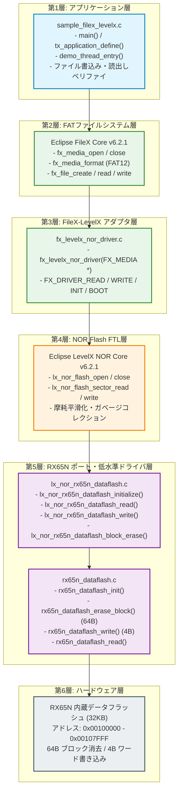
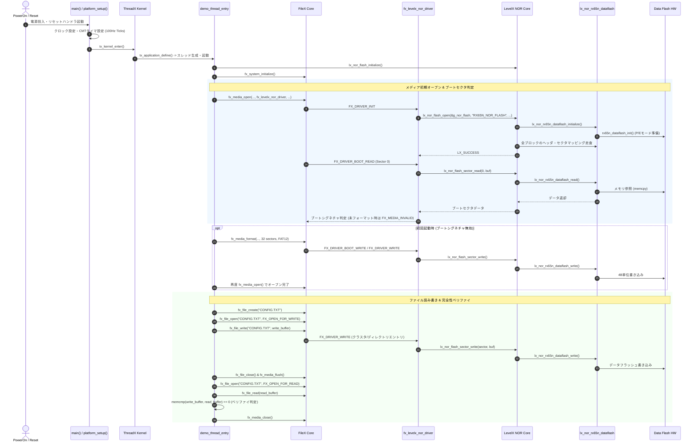
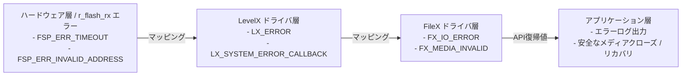

# Renesas RX65N FileX + LevelX Data Flash ポート基本設計書

---

## 改訂履歴

| 版数 | 日付 | 作成者 / 更新者 | 改訂内容 |
| :--- | :--- | :--- | :--- |
| 1.00 | 2026/10/10 | システム開発チーム | 初版作成（FileX、LevelX NOR、RX65N内蔵データフラッシュ3層統合設計） |

---

## 目次

1. [第1章 システム概要およびハードウェア仕様](#第1章-システム概要およびハードウェア仕様)
   1. [1.1 開発背景と目的](#11-開発背景と目的)
   2. [1.2 対象MCUハードウェア仕様](#12-対象mcuハードウェア仕様)
   3. [1.3 内蔵データフラッシュ詳細仕様](#13-内蔵データフラッシュ詳細仕様)
   4. [1.4 開発環境およびツールチェーン](#14-開発環境およびツールチェーン)
2. [第2章 ソフトウェア全体アーキテクチャ](#第2章-ソフトウェア全体アーキテクチャ)
   1. [2.1 レイヤードアーキテクチャ設計](#21-レイヤードアーキテクチャ設計)
   2. [2.2 システム全体ブロック図](#22-システム全体ブロック図)
   3. [2.3 実行制御フロー・シーケンス](#23-実行制御フローシーケンス)
3. [第3章 メモリ管理・セクション配置設計](#第3章-メモリ管理セクション配置設計)
   1. [3.1 メモリマップ](#31-メモリマップ)
   2. [3.2 SRAMバッファ設計](#32-sramバッファ設計)
   3. [3.3 スタックおよびヒープ設計](#33-スタックおよびヒープ設計)
4. [第4章 RTOSタスク・スケジューリング設計](#第4章-rtosタスクスケジューリング設計)
   1. [4.1 ThreadX タスク構成](#41-threadx-タスク構成)
   2. [4.2 排他制御設計（マルチスレッド保護）](#42-排他制御設計マルチスレッド保護)
5. [第5章 データフラッシュおよび LevelX ポート層設計](#第5章-データフラッシュおよび-levelx-ポート層設計)
   1. [5.1 低水準データフラッシュ制御API](#51-低水準データフラッシュ制御api)
   2. [5.2 LevelX NOR Flash ポートドライバ仕様](#52-levelx-nor-flash-ポートドライバ仕様)
   3. [5.3 ブロック・セクタサイズ整合設計](#53-ブロックセクタサイズ整合設計)
6. [第6章 ファイルシステムおよびウェアレベリング設計](#第6章-ファイルシステムおよびウェアレベリング設計)
   1. [6.1 FAT12 ジオメトリ設計](#61-fat12-ジオメトリ設計)
   2. [6.2 LevelX NOR 摩耗平滑化（ウェアレベリング）機構](#62-levelx-nor-摩耗平滑化ウェアレベリング機構)
   3. [6.3 ガベージコレクションおよびブロック再利用](#63-ガベージコレクションおよびブロック再利用)
7. [第7章 信頼性・フェイルセーフ・エラーハンドリング設計](#第7章-信頼性フェイルセーフエラーハンドリング設計)
   1. [7.1 境界外アクセス防止とパラメータ検証](#71-境界外アクセス防止とパラメータ検証)
   2. [7.2 書き込み前消去ベリファイ](#72-書き込み前消去ベリファイ)
   3. [7.3 エラーコード体系とステータス伝播](#73-エラーコード体系とステータス伝播)

---

## 第1章 システム概要およびハードウェア仕様

### 1.1 開発背景と目的
組込みシステムにおいて、設定パラメータや稼働ログ、障害トレース情報などを不揮発性ストレージへ保存する要求は必須である。ルネサス エレクトロニクス製 RX65N マイクロコントローラには 32 KB の内蔵データフラッシュが搭載されているが、FAT 等のファイルシステムを直接適用した場合、以下の課題が生じる。

1. **書き換え寿命の偏り**: FAT テーブルやディレクトリエントリが特定のアドレスに集中して書き込まれ、素子の書き換え上限（約 10 万回）に早期に到達する。
2. **消去・書込み単位の不整合**: ハードウェアの最小消去単位（64 バイト）および書込み単位（4 バイト）と、FAT の論理セクタ単位（通常 512 バイト）のミスマッチ。

本設計では、**Eclipse FileX (FAT12)** の下層に **Eclipse LevelX (NOR Flash FTL: Flash Translation Layer)** を導入し、論理セクタ・物理セクタ間の動的アドレス変換および動的ウェアレベリング（摩耗平滑化）を施すことで、32 KB という極小データフラッシュ上での高信頼かつ長寿命なファイルストレージシステムを構築する。

### 1.2 対象MCUハードウェア仕様
- **型番**: R5F565NEDDFB (100ピン LFQFP)
- **CPUコア**: RXv2 コア（最高 120 MHz 動作、単精度 FPU 搭載）
- **内蔵RAM**: 256 KB (RAM: `0x00000000` - `0x0003FFFF`)
- **拡張RAM**: 384 KB (RAM2: `0x00800000` - `0x0085FFFF`)
- **内蔵ROM (Code Flash)**: 2 MB (`0xFFE00000` - `0xFFFFFFFF`)
- **内蔵データフラッシュ**: 32 KB (`0x00100000` - `0x00107FFF`)

### 1.3 内蔵データフラッシュ詳細仕様
| 項目 | ハードウェア仕様値 | 備考 |
| :--- | :--- | :--- |
| **アドレス範囲** | `0x00100000` 〜 `0x00107FFF` | 計 32,768 バイト (32 KB) |
| **読み出し動作** | メモリマップドリード (通常のポインタ参照 / `memcpy` 可能) | CPU クロック同期で即座に読み出し可能 |
| **最小消去単位** | **64 バイト** | 全 512 個の物理ハードウェアブロック |
| **最小書込み単位** | **4 バイト (1 ワード)** | 4 バイト境界アライメント必須 |
| **消去後初期状態** | 全ビット `1` (`0xFF`) | 書き込み時はビットを `0` へ遷移させる |
| **P/E コントローラ** | 内蔵 FCU (Flash Control Unit) / FACI | P/E モード遷移後にコマンドシーケンスを発行 |
| **書換え保証回数** | 100,000 回 (Typ.) | ウェアレベリングにより寿命を最大化 |

### 1.4 開発環境およびツールチェーン
- **統合開発環境**: Renesas e2 studio 2024 以降
- **コンパイラ**: GCC for Renesas RX 14.2.0 (Newlib C ライブラリ)
- **ターゲット言語仕様**: C99 (`-std=gnu99`)
- **CPU アーキテクチャ設定**: `-misa=v2`, `-m64bit-doubles`, `-mlittle-endian-data`
- **最適化オプション**: `-O2 -ffunction-sections -fdata-sections -fno-strict-aliasing`
- **使用ミドルウェアバージョン**:
  - Eclipse ThreadX: `v6.2.1`
  - Eclipse FileX: `v6.2.1`
  - Eclipse LevelX: `v6.2.1_rel`
  - Renesas Board Support Package (r_bsp): `v7.30`
  - Renesas Flash Driver (r_flash_rx): `v5.21`

---

## 第2章 ソフトウェア全体アーキテクチャ

### 2.1 レイヤードアーキテクチャ設計
本システムは、明確に責務を分離した 5 層のレイヤードアーキテクチャで構成される。

1. **アプリケーション層 (`src/app/sample_filex_levelx.c`)**:
   - ファイルの作成、オープン、読み書き、シーク、クローズおよびデータの完全性検証を実行。
2. **ファイルシステム層 (`libs/filex/`)**:
   - FAT12 ディレクトリ構造、クラスタチェーン管理、タイムスタンプ、ボリューム情報の抽象化。
3. **FTL アダプタ層 (`src/driver/fx_levelx_nor_driver.c`)**:
   - FileX の I/O 要求（`FX_DRIVER_READ`, `WRITE`, `BOOT_READ`, `BOOT_WRITE` 等）を受け取り、LevelX の NOR API へブリッジ。
4. **FTL 摩耗平滑化層 (`libs/levelx/common/`)**:
   - 論理セクタ番号から物理ブロック/物理セクタへの変換、ブロック消去回数の記録、消去ブロック再配分。
5. **低水準フラッシュドライバ層 (`src/driver/lx_nor_rx65n_dataflash.c`, `src/driver/rx65n_dataflash.c`)**:
   - LevelX の要求する NOR Flash 仮想ブロック操作を、RX65N ハードウェア（64B消去、4B書き込み）のアクセス仕様へ変換。
6. **ハードウェア層**:
   - RX65N 内蔵データフラッシュおよび Flash Control Unit (FCU)。

### 2.2 システム全体ブロック図



### 2.3 実行制御フロー・シーケンス

システム起動時からファイル検証完了までの一連の処理フローを以下に示す。



---

## 第3章 メモリ管理・セクション配置設計

### 3.1 メモリマップ
RX65N の全アドレス空間における本システムのリソース配置は以下の通りである。

| 領域名 | 開始アドレス | 終了アドレス | サイズ | 用途・セクション |
| :--- | :--- | :--- | :--- | :--- |
| **RAM** | `0x00000000` | `0x0003FFFF` | 256 KB | 内部変数 (`.data`, `.bss`), スレッドスタック, FileX セクタバッファ |
| **Data Flash** | `0x00100000` | `0x00107FFF` | 32 KB | LevelX NOR Flash 物理管理領域（FTLストレージ） |
| **拡張 RAM2** | `0x00800000` | `0x0085FFFF` | 384 KB | 将来の拡張用（通信バッファ等） |
| **Code Flash (ROM)** | `0xFFE00000` | `0xFFFFFFFF` | 2 MB | プログラムコード (`.text`), 定数 (`.rodata`), ベクタテーブル |

### 3.2 SRAMバッファ設計
LevelX および FileX の動作に必要となる SRAM バッファサイズを最小化しつつ、512 バイトセクタの整合性を確保する。

1. **FileX セクタキャッシュバッファ (`media_memory`)**:
   - サイズ: **512 バイト**
   - 配置: `RAM` 内静的変数
   - 用途: FileX が FAT セクタ、ディレクトリエントリ、ファイルデータセクタを読み書きするための作業バッファ。
2. **LevelX セクタ転送バッファ (`g_lx_nor_sector_buffer`)**:
   - サイズ: **512 バイト** (`LX_NOR_SECTOR_SIZE * 4`)
   - 配置: `RAM` 内静的配列
   - 用途: LevelX コアがセクタ移動やガベージコレクション時にワード境界単位でデータ待避を行うバッファ。
3. **LevelX コントロールブロック (`g_nor_flash`, `levelx_media`)**:
   - サイズ: 合計約 1.5 KB
   - 用途: LevelX NOR Flash インスタンス制御構造体 (`LX_NOR_FLASH`) および FileX メディア制御構造体 (`FX_MEDIA`)。

### 3.3 スタックおよびヒープ設計
- **メインスタック (`_istack`)**:
  - サイズ: 4,096 バイト (割込みハンドラおよび OS 起動前用)
- **デモタスクスタック (`demo_thread_stack`)**:
  - サイズ: **2,048 バイト**
  - FileX / LevelX のスタック消費量は呼出しネスト最大深度で約 1,024 バイトであり、マージンを含めて 2,048 バイトを割り当て。
- **ヒープメモリ**:
  - FileX, LevelX, ThreadX はすべて静的バッファ割り当てを行っており、動的ヒープ（`malloc`）は不使用。

---

## 第4章 RTOSタスク・スケジューリング設計

### 4.1 ThreadX タスク構成

| タスク名称 | 関数エントリ | 優先度 | タイムスライス | スタックサイズ | 役割 |
| :--- | :--- | :--- | :--- | :--- | :--- |
| **FileX_LevelX_Demo** | `demo_thread_entry` | 1 (高) | 無効 (`TX_NO_TIME_SLICE`) | 2,048 バイト | メディアマウント、FAT12フォーマット、ファイル入出力ベリファイ |
| **System Timer** | `_tx_timer_interrupt` | 割込み (CMT0) | - | 割込みスタック | 10ms 周期の OS システムティック供給 |

### 4.2 排他制御設計（マルチスレッド保護）
FileX および LevelX は、複数タスクからの同時アクセスに対する以下の排他制御機構を備える。

1. **FileX メディアミューテックス**:
   - FileX 内部で `FX_MEDIA` 構造体ごとに ThreadX ミューテックスが自動作成される。
   - `fx_file_read()`, `fx_file_write()` 呼び出し時はメディアミューテックスが獲得され、他のスレッドからの同一メディアに対する I/O 競合を防止する。
2. **フラッシュ書き込み中のハードウェア保護**:
   - RX65N データフラッシュは、書き込み（P/E）実行中に他のブロックへの同時アクセスが禁止される。
   - 低水準ドライバ `rx65n_dataflash_write()` / `erase()` 内で完了フラグ（FSTATR レジスタの FRDY ビット）をポーリング監視し、操作完了までブロックすることでハードウェアの競合状態（Race Condition）を排除する。

---

## 第5章 データフラッシュおよび LevelX ポート層設計

### 5.1 低水準データフラッシュ制御API (`rx65n_dataflash.c / .h`)

```c
/* 初期化: P/Eモードへの移行準備 */
fsp_err_t rx65n_dataflash_init(void);

/* 64バイトのハードウェアブロック消去 */
fsp_err_t rx65n_dataflash_erase_block(uint32_t block_address);

/* 連続するハードウェアブロックの一括消去 */
fsp_err_t rx65n_dataflash_erase(uint32_t start_address, uint32_t num_blocks);

/* データフラッシュ全領域（32KB）の一括消去 */
fsp_err_t rx65n_dataflash_erase_all(void);

/* 4バイト（1ワード）境界でのデータ書き込み */
fsp_err_t rx65n_dataflash_write(const uint8_t *src_addr, uint32_t flash_addr, uint32_t byte_count);

/* メモリマップドリードによる高速データ読み出し */
fsp_err_t rx65n_dataflash_read(uint32_t flash_addr, uint8_t *dst_buf, uint32_t byte_count);
```

### 5.2 LevelX NOR Flash ポートドライバ仕様 (`lx_nor_rx65n_dataflash.c / .h`)
LevelX NOR Flash コアが必要とする 5 つのドライバ関数インターフェースを実装。

1. **`lx_nor_rx65n_dataflash_initialize(LX_NOR_FLASH *nor_flash)`**:
   - 総ブロック数（8ブロック）、1ブロックあたりのワード数（1,024ワード）、ドライバ関数ポインタ群を登録。
2. **`lx_nor_rx65n_dataflash_read(ULONG *flash_address, ULONG *destination, ULONG words)`**:
   - フラッシュアドレスから指定ワード数（4バイト単位）を読み出し。
3. **`lx_nor_rx65n_dataflash_write(ULONG *flash_address, ULONG *source, ULONG words)`**:
   - フラッシュアドレスへ指定ワード数を 4 バイト境界で書き込み。
4. **`lx_nor_rx65n_dataflash_block_erase(ULONG block, ULONG erase_count)`**:
   - LevelX 仮想ブロック番号をハードウェアアドレスに換算し、内包する 64 個の 64B ハードウェアブロックを一括消去。
5. **`lx_nor_rx65n_dataflash_block_erased_verify(ULONG block)`**:
   - 消去後のブロック全体が `0xFFFFFFFF` になっているかを全ワード走査して検証。

### 5.3 ブロック・セクタサイズ整合設計

LevelX の仕様上、1 つの NOR ブロック内には **最低 1 セクタの管理ヘッダ (512B)** と **1 セクタ以上の物理データセクタ (512B)** が収まる必要がある。

- **RX65N データフラッシュ総容量**: 32,768 バイト (32 KB)
- **ハードウェア最小消去ブロック**: 64 バイト (計 512 個)
- **LevelX 仮想 NOR ブロックサイズ**: **4,096 バイト (4 KB)**
  - 1 個の LevelX ブロック = **64 個の HW 消去ブロック** ($64 \times 64 = 4,096\text{ B}$)
  - 総 LevelX ブロック数 = **8 ブロック** ($32\text{ KB} / 4\text{ KB} = 8$)
- **LevelX ブロック内のセクタ内訳**:
  - ブロックサイズ 4,096 バイト = 512 バイトセクタ $\times 8$
  - **1 セクタ (512B)**: LevelX ブロックヘッダ領域 (消去回数、ビットマップ、マッピング情報)
  - **7 セクタ (3,584B)**: 物理データセクタ領域
- **総物理セクタ数**: $8\text{ ブロック} \times 7 = 56\text{ 物理セクタ}$
- **予約ブロック**: LevelX はガベージコレクション用として常時 1 ブロックを空き予約とするため、利用可能な論理セクタ数は最大 $7 \times (8 - 1) = 49\text{ セクタ}$（24.5 KB 相当）。
  FileX フォーマットではマージンを考慮して **32 セクタ (16 KB)** を割り当て。

```text
+-----------------------------------------------------------------------------------------+
| LevelX 仮想ブロック (4,096 バイト = 64 × 64B HW消去ブロック)                              |
+--------------------------+--------------------------------------------------------------+
| セクタ 0 (512 バイト)     | セクタ 1〜7 (512 バイト × 7 = 3,584 バイト)                   |
| LevelX ブロック管理ヘッダ  | 物理データセクタ (FileX の論理セクタが動的にマッピングされる領域)  |
+--------------------------+--------------------------------------------------------------+
```

---

## 第6章 ファイルシステムおよびウェアレベリング設計

### 6.1 FAT12 ジオメトリ設計
FileX は FAT12 形式でフォーマットされ、以下のパラメータで構成される。

| パラメータ | 設定値 | 根拠・設計意図 |
| :--- | :--- | :--- |
| **セクタサイズ** | **512 バイト** | LevelX NOR Flash の標準セクタ単位 |
| **総セクタ数** | **32 セクタ (16 KB)** | LevelX の利用可能セクタ数（45）以内に収め、ウェアレベリング余剰領域を確保 |
| **クラスタサイズ** | **1 セクタ (512 バイト)** | 小容量メディアにおけるクラスタ内無駄容量（内部断片化）の最小化 |
| **FAT テーブル数** | **1** | フラッシュ容量節約のため冗長 FAT（FAT2）を省略 |
| **ルートディレクトリエントリ数** | **32 エントリ** | 1 エントリ 32 バイトのため、ディレクトリエリアは 2 セクタ (1,024B) を占有 |
| **ボリュームラベル** | `"RX_LX_NOR"` | 11 文字の標準 FAT ラベル |

### 6.2 LevelX NOR 摩耗平滑化（ウェアレベリング）機構
1. **論理セクタの動的配置**:
   - FileX が同一の論理セクタ（例: FAT テーブルが存在するセクタ 1）に繰り返し書き込みを行う場合、LevelX はそのセクタを上書き消去せず、**消去済みの別の物理セクタへ追記書き込み**を行う。
   - 旧セクタは「無効（Invalid）」としてマークされ、マッピングテーブルが更新される。
2. **消去回数平滑化 (Erase Count Leveling)**:
   - 各ブロックのヘッダにブロック消去回数が記録される。
   - 空きブロックが必要になった際、消去回数が最も少ないブロックが優先的に選択され、特定ブロックの過剰摩耗を防ぐ。

### 6.3 ガベージコレクションおよびブロック再利用
- 有効セクタと無効セクタが混在し空きセクタが減少すると、LevelX は自動的に**ブロックの再利用処理（Reclaim / Defragmentation）**を開始する。
- 最も無効セクタの多いブロックを回収対象として選定し、そこに残存する有効セクタを別の空きブロックへ退避コピーした後、回収対象ブロック（2,048 バイト = 32 HW ブロック）を一括消去して新たな空きブロックへ復帰させる。

---

## 第7章 信頼性・フェイルセーフ・エラーハンドリング設計

### 7.1 境界外アクセス防止とパラメータ検証
- **アドレス境界チェック**:
  - `rx65n_dataflash_write()` および `read()` において、アクセス範囲がデータフラッシュ領域（`0x00100000` 〜 `0x00107FFF`）を 1 バイトでも超過する場合は即座に `FSP_ERR_INVALID_ADDRESS` / `FSP_ERR_INVALID_SIZE` を返却する。
- **アライメントチェック**:
  - 書き込み先アドレスおよび書き込みサイズが 4 バイト境界（ワード境界）に整列しているかをビット演算 `(addr & 0x03)` で検証。

### 7.2 書き込み前消去ベリファイ
- ハードウェア消去処理の実行後、`lx_nor_rx65n_dataflash_block_erased_verify()` を呼び出し。
- 消去された 2,048 バイトの全ワード（512 ワード）が完全に `0xFFFFFFFF` に遷移しているかをメモリマップドリードで全件ベリファイ。消去不良ビット（Stuck-at fault）を早期検知する。

### 7.3 エラーコード体系とステータス伝播
下位層で発生した異常は、適切に上位層へ変換・伝播され、システム停止（Hang）を防止する。



1. **タイムアウト防止**:
   - P/E モード制御ループに最大タイムアウトカウンタを配備し、万一のハードウェアハングアップ時にも無限ループへ陥らず安全にエラー復帰する。
2. **FileX メディア無効化通知**:
   - ブートセクタ判定失敗時、ドライバは `FX_MEDIA_INVALID` を通知し、上位アプリケーションが安全に再フォーマット処理へフォールバックできるように設計。
