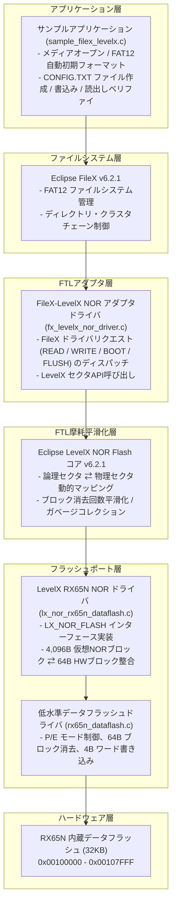

# Renesas RX65N FileX + LevelX Data Flash Porting Reference Project

[-blue.svg)](https://www.renesas.com/products/microcontrollers-microprocessors/rx-family/rx600-series/rx65n-rx651)
[](https://github.com/eclipse-threadx/threadx)
[](https://github.com/eclipse-threadx/filex)
[](https://github.com/eclipse-threadx/levelx)
[](https://gcc-renesas.com/)

---

## 1. プロジェクト概要

本リポジトリは、**Renesas RX65N（RXv2 コア、120MHz）** の内蔵データフラッシュ（32 KB）をストレージメディアとして、**Eclipse FileX（FAT12 ファイルシステム）** および **Eclipse LevelX（NOR Flash Wear-Leveling FTL）** を完全統合した高信頼性組込みファイルシステムのリファレンス実装です。

小容量内蔵データフラッシュ（消去単位 64 バイト / 書込み単位 4 バイト）に対して、LevelX による摩耗平滑化（ウェアレベリング）および論理・物理セクタ管理を適用し、FAT ファイルシステムの高頻度書き換えによる特定領域の素子劣化を防止した安全な不揮発性ストレージ機能を提供します。

詳細な設計思想、メモリ配置、ジオメトリ仕様、シーケンス、および信頼性設計については、[基本設計書 (BASIC_DESIGN_SPECIFICATION.md)](BASIC_DESIGN_SPECIFICATION.md) を参照してください。

---

## 2. ソフトウェアアーキテクチャ構成



---

## 3. リポジトリ構成

```text
filex_renesas_rx/
├── BASIC_DESIGN_SPECIFICATION.md      # 基本設計書（全7章）
├── PORTING_GUIDE.md                   # FileX + LevelX ポーティング解説および利用ガイド (Japanese)
├── PORTING_GUIDE_EN.md                # FileX + LevelX Porting Guide & Usage Manual (English)
├── README.md                          # 本書
├── .cproject                          # e2 studio プロジェクト設定 (GCC for RX 14.2)
├── .project                           # Eclipse プロジェクト定義
├── .gitignore                         # ビルド生成物・一時ファイル除外設定
├── HardwareDebug/                     # ビルド用 Makefile および生成スクリプト
│   ├── makefile                       # トップレベル Makefile
│   └── sources.mk                     # ビルド対象ソース一覧
├── libs/                              # Azure RTOS / Eclipse ThreadX スタック
│   ├── threadx/                       # ThreadX v6.2.1 コアおよび RXv2 GNU ポート
│   ├── filex/                         # FileX v6.2.1 FAT ファイルシステム
│   └── levelx/                        # LevelX v6.2.1 NOR Flash ウェアレベリング
│       └── common/
│           ├── inc/lx_api.h           # LevelX API ヘッダ
│           └── src/                   # LevelX NOR フラッシュ コア実装
└── src/                               # ユーザーアプリケーション・ドライバソース
    ├── app/                           # アプリケーション層
    │   ├── sample_filex_levelx.c      # FileX + LevelX 動作確認サンプル
    │   └── sample_filex_levelx.h      # サンプルヘッダ
    ├── driver/                        # ポート・ドライバ層
    │   ├── rx65n_dataflash.c / .h     # RX65N 内蔵データフラッシュ低水準ドライバ
    │   ├── lx_nor_rx65n_dataflash.c / .h # LevelX NOR フラッシュドライバ
    │   └── fx_levelx_nor_driver.c / .h # FileX - LevelX ブリッジアダプタ
    ├── rtos_config/                   # ThreadX オブジェクト初期化
    ├── smc_gen/                       # Smart Configurator 生成コード (r_bsp, r_cmt_rx, r_flash_rx)
    ├── hardware_setup.c / .h          # タイマ・クロック・ペリフェラル初期化
    └── linker_script.ld               # RX65N GNU リンカスクリプト
```

---

## 4. ハードウェア要件および開発環境

### 対象ハードウェア
- **MCU**: Renesas RX65N (型番: `R5F565NEDDFB`, 100ピン LFQFP)
  - コア: RXv2 (最高 120 MHz 動作)
  - 内蔵 RAM: 256 KB (0x00000000 - 0x0003FFFF) + 拡張 RAM 384 KB (0x00800000 - 0x0085FFFF)
  - 内蔵 ROM: 2 MB (0xFFE00000 - 0xFFFFFFFF)
  - データフラッシュ: 32 KB (0x00100000 - 0x00107FFF)
- **評価ボード**:
  - Renesas Target Board for RX65N (RTK5RX65N0C00000BR)
  - Renesas Envision Kit RX65N または Renesas RX65N Cloud Kit
- **ログ出力仕様**:
  - e2 studio の **Renesas Debug Console**（GDB / セミホスティング `stdout` 出力）経由でログを表示します。
  - ※ 外部シリアル通信（UART/Tera Term 等）へのリダイレクトではなく、デバッガ標準コンソールを使用します。

### 開発ツールチェーン
- **IDE**: Renesas e2 studio (2024 以降推奨)
- **コンパイラ**: GCC for Renesas RX 14.2.0 (Newlib、C99/gnu99 規格)
- **ビルドツール**: GNU Make (`mingw32-make.exe` 4.x)
- **デバッガ**: E2 emulator Lite / E2 emulator / J-Link OB

---

## 5. ビルド・実行手順

### 手順 A: コマンドライン (Makefile) によるクリーンビルド

GCC for Renesas RX のパスが環境変数 `PATH` に通っている状態で、`HardwareDebug` フォルダに移動して実行します。

```powershell
# 1. HardwareDebug フォルダへ移動
cd HardwareDebug

# 2. クリーン処理
mingw32-make.exe clean

# 3. 並列ビルドの実行 (8スレッド)
mingw32-make.exe -j8 all
```

ビルドが成功すると、`HardwareDebug/filex_renesas_rx.elf` および書き込み用 `HardwareDebug/filex_renesas_rx.mot` が生成されます。

### 手順 B: e2 studio IDE でのインポート・ビルド

1. e2 studio を起動し、ワークスペースを開きます。
2. `[ファイル]` -> `[インポート]` -> `[既存のプロジェクトをワークスペースへ]` を選択します。
3. ルートディレクトリに本リポジトリフォルダを選択し、`filex_renesas_rx` をインポートします。
4. プロジェクトを選択し、アクティブ構成が `HardwareDebug` になっていることを確認して `[プロジェクト]` -> `[プロジェクトのビルド]` を実行します。

---

## 6. 動作確認および期待ログ出力

e2 studio 上でデバッグ実行（F8 等）を開始すると、**Renesas Debug Console** ビューに実行ログが出力されます。

### 期待されるコンソール出力例

```text
===============================================================
  Renesas RX65N FileX + LevelX NOR Flash (32KB Data Flash) Demo
===============================================================
[Demo] Opening media via fx_levelx_nor_driver...
[Demo] Media open returned status 0x03 (Unformatted / Invalid boot record).
[Demo] Formatting Data Flash via LevelX NOR Driver as FAT12 (32 sectors)...
[Demo] FAT12 format completed successfully.
[Demo] Re-opening media after format...
[Demo] Media opened successfully.
[Demo] Creating file: CONFIG.TXT...
[Demo] File CONFIG.TXT created successfully.
[Demo] Opening CONFIG.TXT for writing...
[Demo] Writing 64 bytes: Renesas RX65N FileX + LevelX NOR Flash Test OK! [Cycle #1]
[Demo] File written and closed successfully.
[Demo] Opening CONFIG.TXT for reading...
[Demo] Read payload (64 bytes): Renesas RX65N FileX + LevelX NOR Flash Test OK! [Cycle #1]
[Demo] >>> DATA VERIFICATION SUCCESS: Data matches perfectly! <<<
[Demo] Media closed successfully. Demo completed.
===============================================================
```

> **Note**: 2回目以降の再起動時は、ブートセクタが保持されているためフォーマット処理はスキップされ、即座にメディアがオープンされて `CONFIG.TXT already exists on media.` と表示され、ファイル更新・読み出し検証が行われます。

---

## 7. ライセンス

本プロジェクトは以下のライセンス条項に基づきます。
- **Eclipse ThreadX, FileX, LevelX**: Eclipse Public License 2.0 (EPL-2.0) / MIT License
- **Renesas Smart Configurator / FIT (BSP, Flash driver)**: Renesas Software License Agreement
- **サンプル・ポート層コード**: MIT License